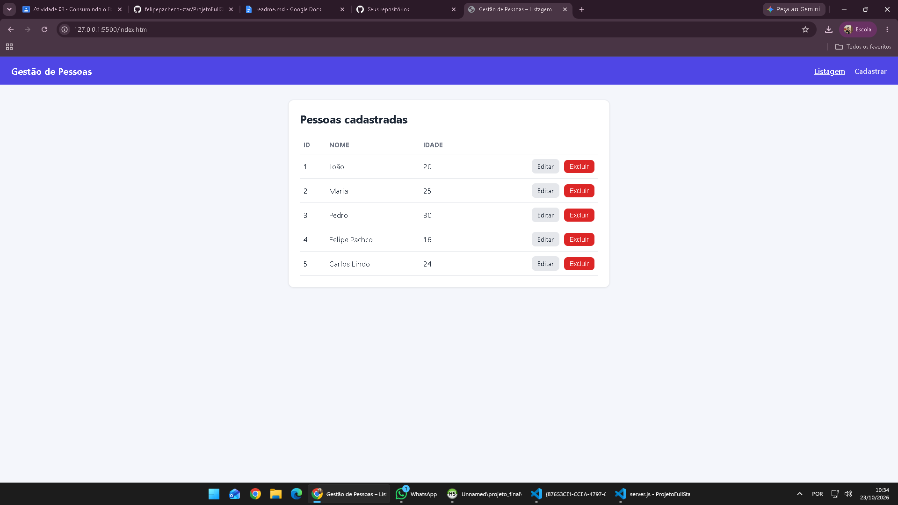
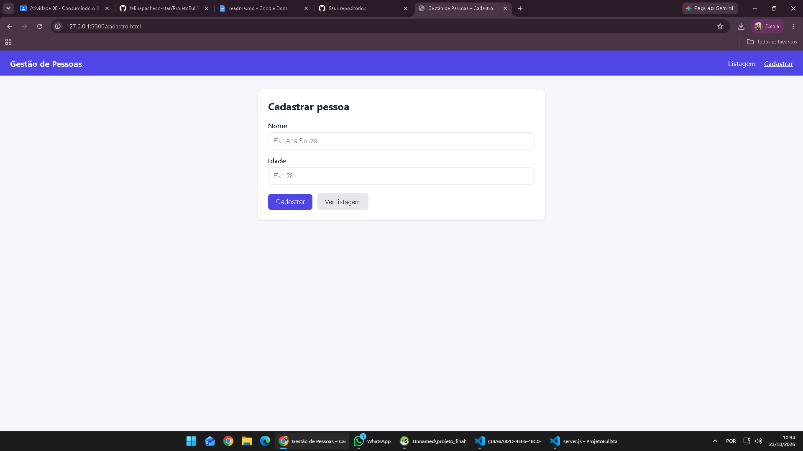
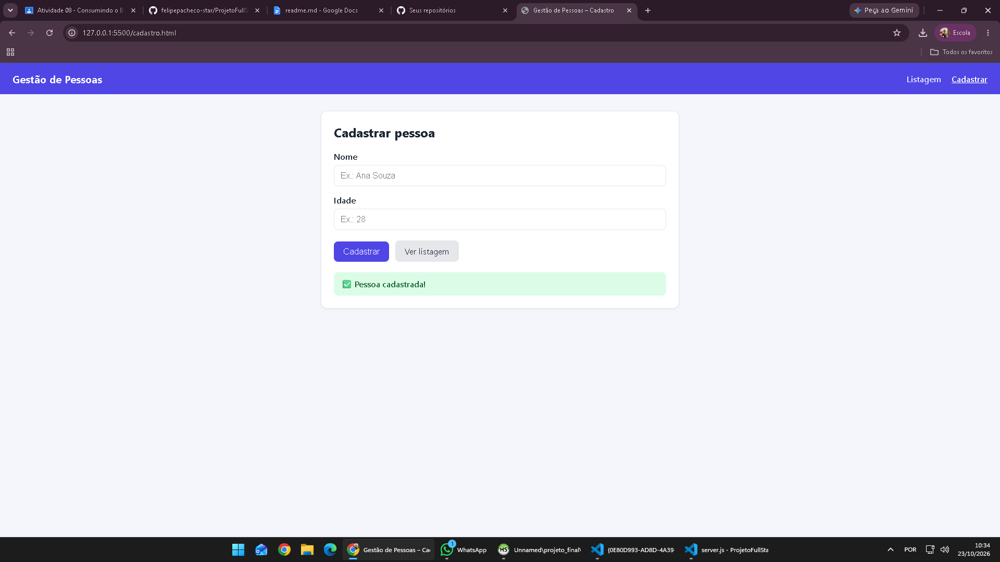
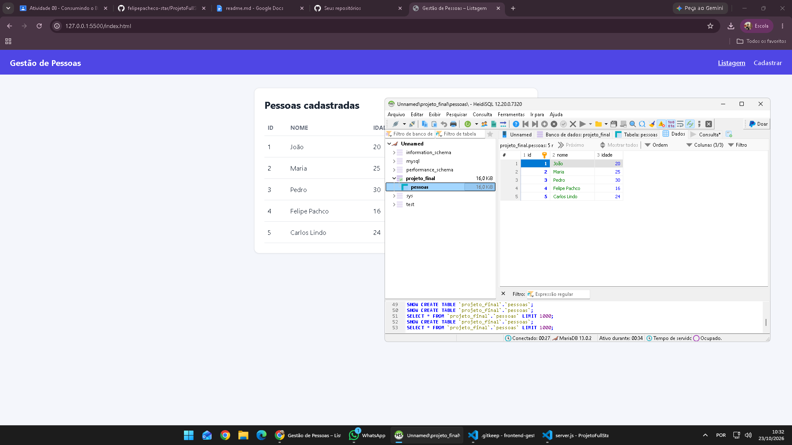

# Front-End – Sistema de Gestão de Pessoas

**Atividade 08 – Consumindo o Back-End no Front-End – CRUD**

| | |
|---|---|
| **Professor** | Vitor Lima Santana |
| **Aluno(a)** | [Nome completo] |
| **Disciplina** | Programação Back-End |

## 1. Objetivo

Aplicação Front-End em HTML, CSS e JavaScript que consome uma API REST em Node.js, Express e MySQL/MariaDB. O foco é o cadastro de pessoas com o método HTTP `POST`, a função `fetch()` e o tratamento de erros com `async/await` e `try/catch`. Também foram implementadas a listagem, a edição e a exclusão.

## 2. Tecnologias utilizadas

- HTML5
- CSS3
- JavaScript (Fetch API, async/await, try/catch)
- Node.js e Express (Back-End)
- MySQL/MariaDB (banco de dados)

## 3. Estrutura do projeto

```text
frontend-gestao-pessoas/
│
├── index.html        # listagem (e exclusão)
├── cadastro.html     # formulário de cadastro
├── editar.html       # formulário de edição
│
├── css/
│   └── style.css
│
├── js/
│   ├── listar.js     # GET /pessoas e DELETE /pessoas/:id
│   ├── cadastro.js   # POST /pessoas
│   └── editar.js     # GET /pessoas/:id e PUT /pessoas/:id
│
├── img/              # capturas de tela
└── README.md
```

## 4. Funcionalidades

| Método | Rota | Funcionalidade | Arquivo |
|---|---|---|---|
| GET | `/pessoas` | Listar pessoas | `listar.js` |
| GET | `/pessoas/:id` | Consultar pessoa | `editar.js` |
| POST | `/pessoas` | Cadastrar pessoa | `cadastro.js` |
| PUT | `/pessoas/:id` | Atualizar pessoa | `editar.js` |
| DELETE | `/pessoas/:id` | Excluir pessoa | `listar.js` |

## 5. Implementação do POST

O arquivo `js/cadastro.js`:

1. escuta o evento `submit` do formulário (`addEventListener`) e chama `preventDefault()` para a página não recarregar;
2. lê e valida `nome` (não vazio) e `idade` (inteiro entre 0 e 130) antes de enviar;
3. dentro de `try/catch`, faz `fetch("http://localhost:3000/pessoas", { method: "POST", ... })` com o cabeçalho `Content-Type: application/json` e o corpo `JSON.stringify({ nome, idade })`;
4. verifica `resposta.ok`: se for falso, lança um erro com a mensagem devolvida pela API;
5. exibe na tela uma mensagem de sucesso (com o ID gerado) ou de erro, inclusive quando a API está fora do ar.

## 6. Como executar

### Back-End

1. Fazer o Fork do repositório do professor: https://github.com/VitorLimaSantana/ProjetoFullStack
2. Clonar o seu fork:
   ```bash
   git clone https://github.com/SEU-USUARIO/ProjetoFullStack.git
   cd ProjetoFullStack
   ```
3. Instalar as dependências:
   ```bash
   npm install
   ```
4. Criar o banco executando o conteúdo de `db.sql` no MySQL/MariaDB.
5. Conferir o arquivo `.env` (`DB_HOST`, `DB_USER`, `DB_PASSWORD`, `DB_NAME`, `PORT`) com os dados do seu banco.
6. Iniciar a API:
   ```bash
   npm start
   ```
   Devem aparecer `Servidor rodando na porta 3000` e `Banco conectado!`. A API fica em `http://localhost:3000`.

### Front-End

1. Abrir esta pasta no Visual Studio Code.
2. Verificar se o Back-End está funcionando.
3. Executar `index.html` com o Live Server.
4. Acessar a página **Cadastrar**.
5. Cadastrar uma pessoa.
6. Conferir na listagem (ou no banco: `SELECT * FROM pessoas;`) se o registro foi salvo.

## 7. Como o Front-End se comunica com o Back-End

```text
Navegador (HTML/CSS/JS)  ──fetch (JSON)──▶  API Express (:3000)  ──SQL──▶  MySQL/MariaDB
        ◀──── resposta JSON ────────────          ◀── resultado ──────
```

- O Front-End roda no navegador (Live Server, geralmente porta 5500) e a API em outra origem (`localhost:3000`). O Back-End usa o middleware `cors()`, que autoriza essas requisições.
- Os dados do formulário são enviados em **JSON** e a API os lê com `express.json()`.
- A API executa o `INSERT` no banco e responde `201` com `{ "mensagem": "Pessoa cadastrada!", "id": ... }`. Em caso de falha, responde `500` com `{ "erro": ... }`.
- O Front-End lê a resposta e mostra a mensagem correspondente ao usuário.

## 8. Evidências

**Imagem 1 – Tela de listagem**



**Imagem 2 – Formulário de cadastro**



**Imagem 3 – Cadastro funcionando**



**Imagem 4 – Registro inserido no banco de dados**



## 9. Repositórios

- Back-End (Fork): [Inserir link]
- Front-End: [Inserir link]

## 10. Conclusão do aluno

[Escreva sua conclusão aqui, com suas palavras: como funciona a comunicação Front-End/Back-End, a finalidade do POST, por que usar async/await e try/catch e quais dificuldades você encontrou.]

---

**Créditos** — Professor responsável: Vitor Lima Santana · Desenvolvido por: [Nome do aluno]

*Atividade 08 – Desenvolvimento Web e Consumo de APIs REST*
